# Anchor — Contexto, Arquitetura e Estado do Projeto

> **Snapshot de referência:** 23 de outubro de 2026
> **Estado:** plataforma de diagnóstico, Fase B e C1 concluídas; overlay C1 fisicamente validado no Windows
> **Objetivo deste documento:** ser a fonte de contexto para pessoas e agentes que continuarem o projeto sem depender do histórico de chats.

## 1. Resumo executivo

O Anchor é um projeto pessoal para investigar se uma referência visual sincronizada com o movimento de um veículo pode reduzir o conflito sensorial associado à cinetose durante o uso de um computador em carros, autocarros ou comboios.

O sistema usa dois dispositivos:

- um celular Android como fonte física de movimento;
- um computador Windows ou Linux como receptor e, futuramente, como overlay visual.

Neste momento, o pipeline técnico básico funciona de ponta a ponta em hardware real:

1. o Android lê aceleração linear, gravidade e giroscópio;
2. o app cria amostras versionadas a aproximadamente 60 Hz;
3. cada amostra é serializada como JSON em um datagrama UDP;
4. o desktop recebe, limita, valida e ordena os pacotes em Rust;
5. o frontend Tauri exibe os dados e métricas em tempo real;
6. o desktop já consegue gerar um perfil de calibração offline v1 a partir de dataset `stationary`, avaliar offline estimadores de roll/pitch, executar uma seleção offline B3b e ligar o núcleo Rust puro B4a ao receiver/Tauri/UI como diagnóstico B4b.

O que existe hoje inclui B5a e B5b opt-in, fisicamente validadas, para medir a integridade do transporte e aproximações de latência sensor → processamento B4b com sincronização NTP-like e incerteza explícita. B5b não mede sensor → tela e não define thresholds de desempenho. A Fase B está concluída. A infraestrutura C1 também foi concluída e fisicamente validada no Windows; o overlay continua estático e provisório, sem movimento real.

## 2. Problema e hipótese do produto

A hipótese que motiva o Anchor é a seguinte:

- o ouvido interno percebe acelerações, curvas e inclinações do veículo;
- os olhos, concentrados em uma tela aparentemente estática, recebem uma referência visual incompatível;
- essa discordância sensorial pode provocar ou agravar enjoo de movimento;
- uma referência visual discreta e sincronizada com o movimento real pode ajudar a reduzir essa discordância.

A visão de produto é uma aplicação de desktop quase invisível: leve, sempre disponível e capaz de desenhar um horizonte, pontos ou outro padrão visual por cima das aplicações do usuário sem impedir o trabalho.

Essa visão é uma hipótese de produto, não uma alegação médica. O projeto ainda precisa estudar literatura, segurança, latência tolerável e validação com usuários antes de afirmar benefício clínico ou terapêutico.

## 3. Princípios de arquitetura

As decisões atuais seguem estes princípios:

1. **Baixa latência acima de entrega perfeita.** Dados de movimento antigos perdem valor rapidamente; por isso o stream usa UDP e não retransmite amostras perdidas.
2. **Amostras completas e independentes.** Cada datagrama carrega uma amostra inteira, de modo que a perda de um pacote não impede a leitura do seguinte.
3. **Contrato antes do transporte.** O protocolo v1 é versionado e validado de forma equivalente em TypeScript e Rust.
4. **Rust no caminho crítico do desktop.** Rede, parsing e estado do receptor ficam no backend Tauri/Rust.
5. **Código nativo no caminho crítico do Android.** Sensores e socket UDP usam módulos Kotlin/TurboModule; React Native coordena estado e interface.
6. **Estado observável.** Mobile, receptor e desktop expõem métricas para que falhas não pareçam sucesso silencioso.
7. **Lifecycle seguro.** Pausa, destruição ou encerramento do app devem parar sensores, socket, workers e Promises pendentes.
8. **Escopo incremental.** Descoberta, pareamento, segurança, overlay e filtros só entram depois que a fatia anterior estiver comprovada.

## 4. Arquitetura atual

```mermaid
flowchart LR
    subgraph Android[Android — React Native + Kotlin]
        Sensors[Sensores Android\nlinear acceleration\ngravity\ngyroscope]
        Aggregator[MotionFrameAggregator\nclock monotônico\nsequence\nlimite 60 Hz]
        JS[MotionCaptureController\nvalidação e serialização]
        Sender[SequentialUdpSender\n1 envio em voo\nlatest-wins]
        Socket[UdpSocketTransport\nDatagramSocket]
        Sensors --> Aggregator --> JS --> Sender --> Socket
    end

    Contract[MotionSampleV1\nJSON UTF-8\nprotocolo v1\n≤ 1024 bytes]
    Network[Wi-Fi/LAN\nUDP porta 57421]

    subgraph Desktop[Desktop — Tauri v2 + Rust + React]
        Receiver[Receptor UDP Rust\nbind 0.0.0.0:57421]
        Validation[Parse + validação\nrate limit + sessão + ordem]
        State[ReceiverState\núltima amostra + métricas]
        Bridge[Ponte Tauri\nevento + snapshot]
        UI[Diagnóstico React]
        Receiver --> Validation --> State --> Bridge --> UI
    end

    Socket --> Contract --> Network --> Receiver
```



### Fluxo de uma amostra

1. O Android registra `TYPE_LINEAR_ACCELERATION`, `TYPE_GRAVITY` e `TYPE_GYROSCOPE` em uma `HandlerThread` dedicada.
2. `MotionFrameAggregator` guarda o último valor de cada sensor e emite no máximo 60 frames por segundo, acionado pelas atualizações do giroscópio.
3. A sessão recebe UUID, sequência `u32` crescente e relógio monotônico relativo em microssegundos.
4. O frame passa para o JavaScript pelo TurboModule.
5. O JavaScript converte e valida o frame como `MotionSampleV1`, serializa JSON UTF-8 e verifica o limite de 1024 bytes.
6. `SequentialUdpSender` mantém apenas um envio nativo pendente. Sob pressão, preserva somente a amostra mais nova.
7. O módulo UDP Kotlin envia o datagrama ao IPv4 e porta escolhidos manualmente.
8. O receptor Rust aceita o datagrama, aplica rate limit, limite de tamanho, parse, validação semântica, sessão e ordenação.
9. Uma amostra aceita atualiza o estado compartilhado e é publicada ao frontend por evento Tauri.
10. O frontend também lê snapshots periódicos para status e métricas.

## 5. Estrutura do monorepo

```text
Anchor/
├── apps/
│   ├── desktop/                 # Tauri v2: Rust + React
│   └── mobile/                  # React Native Android + módulos Kotlin
├── packages/
│   └── protocol/                # Contrato MotionSampleV1, schema e fixtures
├── tools/
│   └── motion-simulator/        # Publicador UDP local para testes
├── docs/                        # Briefings e documentação do projeto
├── package.json                 # Scripts de orquestração da raiz
├── pnpm-lock.yaml
└── pnpm-workspace.yaml
```

O workspace usa pnpm e inclui `apps/*`, `packages/*` e `tools/*`.

## 6. Protocolo de movimento v1

O JSON Schema em `packages/protocol/schema/motion-sample.v1.schema.json` é a especificação normativa. Mudanças incompatíveis devem criar uma nova versão do protocolo.

### Campos

| Campo | Tipo/limite | Significado |
|---|---:|---|
| `protocolVersion` | constante `1` | versão do contrato |
| `kind` | `motion_sample` | discriminador da mensagem |
| `sessionId` | string de 1 a 64 caracteres | identificador opaco, não é autenticação |
| `sequence` | inteiro `0..4294967295` | ordem monotônica na sessão |
| `sessionElapsedUs` | inteiro `0..9007199254740991` | microssegundos desde o começo da sessão |
| `linearAccelerationMps2` | `Vector3`, cada eixo em `-200..200` | aceleração sem gravidade em m/s² |
| `gravityMps2` | `Vector3`, cada eixo em `-20..20` | vetor de gravidade em m/s² |
| `angularVelocityRadS` | `Vector3`, cada eixo em `-100..100` | velocidade angular em rad/s |

`Vector3` contém exatamente `x`, `y` e `z`, todos numéricos e finitos. Campos desconhecidos são rejeitados.

### Referencial assumido pela convencao de montagem

- X positivo: direita do veículo;
- Y positivo: frente do veículo;
- Z positivo: cima.

O uso atual pressupõe o celular deitado, tela para cima, em retrato e com a borda superior apontando para a frente do veículo, documentado nas capturas regeneradas como `flat_screen_up_portrait_top_toward_vehicle_front`. Esse referencial é a hipótese operacional atual de montagem para o protocolo bruto. Parado nessa posição, `gravityMps2.z` deve ficar próximo de `-9.80665`. A fase B1 registrou datasets controlados que confirmaram empiricamente os sinais reais dos eixos sob essa convenção; a calibração B2 e o pipeline B4a/B4b permanecem camadas desktop sobre o protocolo v1 bruto.

### Regras de transporte

- um JSON completo por datagrama;
- codificação UTF-8;
- máximo de 1024 bytes;
- sem fragmentação lógica;
- sem ACK ou retransmissão;
- relógio monotônico relativo, nunca timestamp Unix.

As mesmas fixtures válidas e inválidas são usadas pelos testes TypeScript e Rust.

## 7. Aplicação mobile

### Stack

- React Native 0.83;
- TypeScript/React para controller e interface;
- Kotlin e TurboModules Codegen para sensores e UDP;
- Android é a única plataforma implementada.

### Responsabilidades nativas

`NativeMotionSensorsModule`:

- detecta os três sensores obrigatórios;
- registra sensores fora da thread principal;
- cria uma sessão com UUID;
- usa `SystemClock.elapsedRealtimeNanos()`;
- limita emissão a 60 Hz;
- encerra captura em pause/destroy/invalidate;
- não reativa sensores silenciosamente em background.

`NativeUdpSenderModule` e `NativeUdpSenderController`:

- validam IPv4 e porta;
- possuem um worker e um transporte por sessão manual;
- serializam operações do socket;
- encerram worker, socket e Promises pendentes no lifecycle;
- impedem que uma abertura antiga ressuscite ou feche uma sessão nova;
- permitem que `close()` interrompa um envio bloqueado sem manter o lock do estado.

### Responsabilidades JavaScript

`MotionCaptureController`:

- coordena abertura UDP antes de iniciar sensores;
- converte frames nativos em `MotionSampleV1`;
- rejeita estrutura, limites ou números inválidos;
- calcula taxa observada e idade da amostra;
- transita entre `checking_sensors`, `ready`, `starting`, `active`, `stale`, `stopped`, `unsupported` e `error`;
- encerra captura quando o app sai do primeiro plano.

`SequentialUdpSender`:

- mantém no máximo um `send()` em voo;
- guarda no máximo uma amostra pendente;
- usa coalescência latest-wins;
- contabiliza backpressure, rejeições e erros;
- ignora resoluções tardias de gerações antigas.

### Interface atual

A tela `Anchor Sensor` é uma interface de diagnóstico, não a experiência final. Ela mostra:

- disponibilidade de sensores;
- IPv4 e porta do computador;
- estado do transporte;
- sessão, sequência, taxa e idade;
- métricas de envio;
- vetores atuais;
- instrução de posicionamento;
- aviso explícito de que UDP não confirma recebimento.

O destino é informado manualmente e não é persistido.

### Metro e desenvolvimento em dispositivo físico

`apps/mobile/metro.config.js` observa a raiz do monorepo e os `node_modules` mobile/raiz para resolver os links simbólicos do pnpm e o pacote `@anchor/protocol`.

O workspace `anchor-mobile` também declara `hermes-compiler@0.14.0` diretamente para expor um caminho estável em `apps/mobile/node_modules/hermes-compiler/hermesc/%OS-BIN%/hermesc`, compatível com a resolução esperada pelo plugin Gradle do React Native em ambiente pnpm.

O APK debug atual não contém um bundle JavaScript standalone. Para desenvolvimento físico:

```bash
pnpm dev:mobile
adb reverse tcp:8081 tcp:8081
```

O Metro precisa continuar aberto. O `adb reverse` é usado apenas pelo bundle de desenvolvimento; os datagramas do Anchor continuam seguindo por UDP/Wi-Fi até o IPv4 LAN informado na tela.

Além do debug, agora existe uma variante Android interna `standalone` que:

- é `non-debuggable`;
- incorpora bundle JavaScript e Hermes no APK;
- usa `applicationId` final `com.anchormobile.standalone` para coexistir com `com.anchormobile`;
- usa `versionNameSuffix` `-standalone` e rótulo de aplicação distinto;
- usa a debug keystore apenas para testes internos.

Essa variante não substitui um futuro `release` de distribuição e não deve ser tratada como artefato de produção.

Nesta data, a implementação automatizada da variante standalone existe, o APK foi construído, inspecionado, instalado e validado fisicamente. O app `standalone` abriu sem Metro e sem `adb reverse`, coexistiu com o app debug por causa do `applicationIdSuffix`, e a comunicação Android → Wi-Fi → desktop funcionou no fluxo físico completo da fatia A1.

## 8. Aplicação desktop

### Stack

- Tauri v2;
- Rust/Tokio para rede e estado;
- React/TypeScript para diagnóstico;
- tray icon já existente;
- desenvolvimento e testes físicos realizados em Linux; a integração B4b também foi validada em Windows.

### Receptor UDP

- bind: `0.0.0.0:57421`;
- aceita tráfego por todas as interfaces IPv4;
- taxa esperada: 60 Hz;
- limite técnico: 240 datagramas por segundo;
- buffer detecta payloads acima de 1024 bytes;
- logs são agregados, sem log por pacote.

### Estado, sessão e ordenação

- a primeira amostra válida estabelece a sessão ativa;
- na mesma sessão, `sequence` precisa ser estritamente crescente;
- duplicados e fora de ordem são ignorados e contabilizados;
- uma sessão diferente só assume após 1 segundo sem amostra válida;
- rollover de `u32` não é suportado no MVP;
- a última amostra válida é preservada para diagnóstico.

Status:

- `active`: amostra válida recebida há no máximo 250 ms;
- `stale`: sem amostra válida por mais de 250 ms;
- `disconnected`: sem amostra válida por mais de 1 segundo.

Métricas:

- datagramas recebidos;
- amostras aceitas;
- oversized;
- inválidos;
- duplicados/fora de ordem;
- sessão estrangeira;
- rate limited.

### Ponte Tauri e diagnóstico

O backend publica a última amostra aceita no evento `anchor-motion-sample-v1`. O frontend recebe esse evento para movimento bruto ao vivo e consulta `get_receiver_snapshot` e `get_live_tilt_snapshot` sequencialmente a cada 250 ms para estado, métricas e diagnóstico de tilt processado.

A visualização atual move um marcador diretamente com `linearAccelerationMps2.x/y`. Ela não integra posição, não estima orientação e não representa ainda o horizonte artificial final.

O frontend de diagnóstico mostra `Receptor UDP (todas as interfaces IPv4, porta 57421)`, coerente com o bind real em `0.0.0.0:57421`.

### Infraestrutura de overlay C1

O desktop cria sob demanda uma segunda webview com label único `overlay`. No Windows ela é transparente, sem decoração, always-on-top, fora da barra de tarefas e dimensionada pela work area da tela principal. O backend Rust mantém a fonte de verdade de aberto/fechado, modo e último erro. Abrir entra sempre em configuração; operação ativa click-through. Fechar esconde e reutiliza a mesma janela, impedindo duplicatas.

O tray oferece recuperação independente da webview: mostrar diagnóstico, retornar o overlay à configuração, fechar overlay e sair. Falha ao alternar input esconde a janela, em vez de deixá-la bloqueando o usuário. Plataformas fora de Windows ficam explicitamente indisponíveis e fail-closed até validação própria. O visual C1 é apenas uma moldura/mira estática identificada; não consome `targetTilt` e não implementa C2, interpolação ou suavização.

A primeira validação física, em 23 de outubro de 2026, falhou: `WebviewWindowBuilder::build()` era chamado por um comando Tauri síncrono e bloqueou no Windows, sem resposta ao frontend. A correção torna `open_overlay` assíncrono e executa criação/configuração em `spawn_blocking`, fora da main event loop. O mutex de estado é usado somente para transições curtas `closed → opening → open/closed`; não fica retido durante APIs de janela. O backend invalida a tentativa após 8 segundos e o frontend aplica timeout de 10 segundos, sempre libera o pending local e mostra erro de recuperação. Gerações impedem abertura concorrente e permitem que fechar ou timeout cancelem logicamente uma criação tardia.

Testes automatizados validam a máquina de estados, cancelamento de geração, prevenção de abertura concorrente e timeout do frontend. Eles não criam uma WebView2 real e, portanto, não comprovam transparência, always-on-top, click-through ou ausência de deadlock no Windows. Essas propriedades foram comprovadas pela revalidação física aprovada em 23 de outubro de 2026.

Na revalidação, a janela principal continuou funcionando, `opening` retornou normalmente, a segunda janela apareceu sem timeout e transparência, ausência de decoração, always-on-top e work area foram confirmados. A moldura/mira provisória apareceu, configuração recebeu mouse e operação permitiu interação com outros aplicativos por click-through. O tray recuperou configuração e fechou o overlay; três ciclos abrir/fechar não criaram duplicatas e sempre reabriram em configuração. Fechar preservou o diagnóstico e `Sair` encerrou o processo sem janelas remanescentes. Com isso, C1 foi concluída. Linux e macOS continuam sem validação.

### Calibração offline v1

O desktop agora possui um módulo Rust dedicado em `apps/desktop/src-tauri/src/calibration/` para uma operação offline, determinística e versionada de calibração/zero a partir de datasets `stationary`.

Características da v1:

- calcula a média vetorial da gravidade e uma rotação ativa `deviceToLeveled` que alinha `normalize(meanGravity)` com `(0, 0, -1)`;
- preserva a magnitude medida da gravidade;
- estima bias estacionário da aceleração linear e da velocidade angular no frame do dispositivo;
- grava um perfil JSON estrito com `deny_unknown_fields`;
- separa `createdAtUtc` como instante de criação do perfil e `sourceStartedAtUtc` como início original da captura;
- valida um quality gate com limiares diagnósticos iniciais;
- reporta resíduos após aplicar a própria transformação ao dataset.

Evidência física offline da B2, usando `artifacts/motion-datasets/20260902T221420Z-stationary.ndjson`:

- `quality.passed: true`;
- 902 amostras;
- duração observada de `14.986.690 us`;
- taxa de origem de `60,0254 Hz`;
- correção de inclinação de `5,6488°`;
- gravidade média de `9,8598 m/s²`;
- RMS linear calibrado de `0,0279031 m/s²`;
- RMS angular calibrado de `0,00648794 rad/s`;
- erro angular residual RMS da gravidade de `0,260718°`;
- `yawCalibrated: false`.

Essa validação física cobre a geração offline do perfil, suas transformações estáticas e os resíduos reportados. Ela não transforma o resultado em referencial completo do veículo, porque yaw continua indeterminado.

Limitações deliberadas:

- `yawCalibrated` é sempre `false`;
- não usa magnetômetro;
- não infere direção por movimento;
- produz um `leveled mounting frame`, não um referencial completo do veículo;
- não distingue inclinação do suporte, do veículo e do piso/estrada no instante do zero;
- a aplicação viva do perfil é feita somente pelo runtime B4b configurado explicitamente; ela não altera o protocolo nem transforma o perfil em referencial completo do veículo.

### Núcleo seguro de tilt vivo B4a

O desktop possui `apps/desktop/src-tauri/src/live_motion/`, um núcleo Rust puro e determinístico que prepara um perfil B2 validado, verifica uma política B3b V2 vinculada por fingerprint, instancia um dos três estimadores existentes e produz `LiveTiltSnapshotV1` a partir de `AcceptedSampleEvent`.

Características:

- sem I/O, socket, Tauri, threads, tasks ou consulta interna a relógio real;
- `snapshot(now: Instant)` recebe relógio monotônico injetado;
- política V1 permanece histórica e não ativa o núcleo vivo;
- mismatch de fingerprint gera `unavailable` com alvo neutro;
- a API pública ativa passa por `LiveMotionPipeline`, sem construtor público que permita contornar a proveniência;
- erro invalidante reconstrói o estimador e exige novo warm-up antes de voltar a `valid`;
- `lastSampleAgeMs` é opcional e fica ausente quando nenhuma amostra foi recebida;
- `LiveMotionPipeline` é `Send` para compatibilidade futura com estado compartilhado;
- `yawAvailable=false` sempre;
- somente estado `valid` entrega `targetTilt` diferente de zero;
- limites iniciais: gap contínuo máximo de `100 ms`, warm-up de duas amostras, stale acima de `250 ms`, disconnected acima de `1 s`.

Os limites de `100 ms` e duas amostras são políticas iniciais de engenharia, não limites clínicos. As métricas temporais online medem intervalos de origem, interarrival de recepção e variação relativa; não são latência ponta a ponta.

### Integração diagnóstica de tilt vivo B4b

B4b adiciona uma camada runtime separada em `live_motion::runtime`: carrega explicitamente `ANCHOR_CALIBRATION_PROFILE_PATH` e `ANCHOR_TILT_POLICY_PATH`, cria o `LiveMotionPipeline`, recebe somente `AcceptedSampleEvent` publicados pelo receiver, usa fila bounded com `try_send` e processa eventos em um worker dedicado. Configuração ausente ou inválida deixa o pipeline `unavailable` e `targetTilt` neutro, sem impedir o receiver UDP de iniciar.

O comando Tauri `get_live_tilt_snapshot` é somente leitura e retorna o snapshot atual, incluindo métricas de integração como descartes de ingresso. A UI mostra a seção diagnóstica “Tilt processado” com estado, motivo de neutralização, roll/pitch utilizáveis, idade da última amostra, fingerprint curto e descartes. Fora de `valid`, roll/pitch utilizáveis são neutros. Na fatia B4b, overlay, janela transparente, click-through e medição formal de latência ponta a ponta permaneciam fora de escopo; C1 adicionou depois apenas a infraestrutura de janela, sem conectar `targetTilt`.

### Avaliacao offline de filtros B3a

O desktop possui um modulo Rust dedicado em `apps/desktop/src-tauri/src/motion_filtering/` para avaliar offline estimadores de roll/pitch sobre sinais calibrados.

Caracteristicas da B3a:

- tres candidatos minimos: gravidade sem filtro adicional do Anchor, passa-baixa vetorial de primeira ordem e complementar gyro + gravidade;
- primeira amostra inicializa pela gravidade e atualizacoes usam `dt` real de `sessionElapsedUs`;
- rejeicao direta de `dt` zero, negativo, `NaN` e infinitos nas APIs dos estimadores;
- fixtures sinteticas deterministicas com ground truth independente de quaternion;
- fixture de montagem/bias que prova aplicacao da calibracao B2 antes dos estimadores;
- replay sintetico raw -> perfil B2 da fixture -> estimador;
- JSON sintetico com `summary` global por configuracao e `fixtureResults[]` por fixture;
- relatorio humano e JSON `evaluationReportVersion=1` sem timestamp atual e sem caminho absoluto;
- parametros `low-pass-tau-ms` e `complementary-tau-ms` configuraveis por CLI;
- datasets fisicos reportados apenas como proxies comportamentais com `groundTruthAvailable=false`.

Limitacoes deliberadas:

- nao escolhe vencedor nem parametros de producao;
- nao aplica filtros ao receptor ao vivo;
- nao implementa politica de gaps, stale ou disconnect;
- nao estima yaw;
- nao usa magnetometro;
- nao usa correcao adaptativa por aceleracao linear;
- nao mede latencia fisica entre sensores, pois o payload nao contem timestamps individuais.

### Selecao offline de filtros B3b

O desktop possui uma camada separada `motion_filtering::selection` para transformar a evidencia B3a em uma decisao reproduzivel quando as nove capturas B1 e o perfil B2 estao disponiveis.

Caracteristicas da B3b:

- reutiliza os estimadores, fixtures, metricas e replay da B3a;
- avalia o grid padrao `low-pass tauMs = 25,50,75,100,150,200,300,400,600,800` e `complementary correctionTauMs = 50,75,100,150,250,400,600,1000,1500,2000`, com listas customizaveis por CLI;
- exige exatamente as nove capturas fisicas selecionadas da B1 e o perfil B2 estacionario;
- separa metricas sinteticas com ground truth de proxies fisicos;
- aplica gates estruturais, identifica configuracoes dominadas e calcula fronteira de Pareto com tolerancias fisicas declaradas;
- preserva metricas de evento como `available`, `failed` ou `unavailable`, sem converter indisponibilidade aplicavel em zero;
- usa as capturas fisicas apenas como proxies comportamentais, com `stationary` participando somente como proxy tardio de repouso;
- emite novos JSONs `selectionReportVersion = 2` e relatorio humano deterministico com fingerprint do perfil;
- preserva `TiltEstimatorPolicyV1` como historico e define `TiltEstimatorPolicyV2`, validado, com `yawAvailable=false`, `source=b3b_offline_selection` e `calibrationProfileFingerprint`;
- produz a política que B4b consome somente quando perfil e fingerprint compatíveis são configurados explicitamente.

Se os artifacts fisicos ignorados pelo Git nao estiverem presentes, a CLI falha com erro controlado. Em 1 de outubro de 2026, a seleção física B3b V2 foi executada localmente com as nove capturas B1 regeneradas e o perfil B2 aprovado. Ela escolheu `gravity_no_additional_anchor_filter`, sem parâmetros adicionais, com `yawAvailable = false` e fingerprint `43e9378ae7290c57bd4dbc6b8a2259a3126a4f0159077e268fa0ec2fa07d5797`.

## 9. Simulador de movimento

`@anchor/motion-simulator` permite validar protocolo e receptor sem celular.

Características:

- UDP via `node:dgram`;
- padrões `stationary` e `sine`;
- destino padrão `127.0.0.1:57421`;
- taxa configurável de 1 a 120 Hz, padrão 60 Hz;
- UUID e sequência por execução;
- relógio monotônico;
- limite de 1024 bytes;
- scheduler sequencial baseado em deadlines monotônicos, sem envios sobrepostos nem deriva acumulada;
- shutdown idempotente inclusive no caminho de erro.

Exemplo:

```bash
pnpm dev:simulator -- --duration 5 --pattern sine --rate 60
```

## 10. Validação física concluída

Em 25 de agosto de 2026, a primeira fatia vertical foi validada com um celular Android real e o desktop em Linux na mesma rede Wi-Fi.

### Evidência observada

- destino configurado manualmente no mobile para o receptor local;
- remetente observado pelo desktop na mesma rede local;
- status mobile: ativo;
- status desktop: ativo;
- sensores linear, gravity e gyro: disponíveis;
- idade mostrada pelo snapshot do desktop: 7 ms;
- datagramas recebidos: 1607;
- amostras aceitas: 1607;
- oversized: 0;
- inválidos: 0;
- duplicados/fora de ordem: 0;
- sessão estrangeira: 0;
- rate limited: 0;
- sequência observada avançando de 9448 para 10220;
- gravidade em Z próxima de `-9.80 m/s²` com o aparelho parado.

Isso comprova, para esse ambiente, o funcionamento de sensores → módulos nativos → React Native → protocolo → UDP/Wi-Fi → Rust → Tauri → diagnóstico.

O valor de 7 ms é a idade local da última amostra quando o snapshot foi lido. Ele não mede sozinho a latência ponta a ponta entre clocks dos dois dispositivos.

Em 2 de setembro de 2026, a fatia A1 também foi validada fisicamente com o APK Android `standalone`, sem Metro e sem `adb reverse`.

### Evidência observada na validação standalone

- o APK `standalone` foi instalado e abriu sem erro de bundle, sem ecrã vermelho e sem tentativa de dependência do Metro;
- o `adb reverse` para a porta `8081` não foi usado durante o ensaio;
- a comunicação Android → Wi-Fi → desktop funcionou no fluxo físico completo;
- checklist físico da fatia A1 concluído pelo usuário sem erros;
- taxa aproximada observada no Android: `60,2 Hz`;
- sensores linear, gravity e gyro: disponíveis;
- mais de `1.300` pacotes enviados;
- zero descartes por backpressure;
- zero payloads rejeitados;
- zero erros de envio.

Isso comprova, para esse ambiente, que a variante Android `standalone` interna abre e transmite corretamente sem Metro e sem `adb reverse`, preservando o fluxo físico Android → Wi-Fi → desktop.

### Evidência observada na validação B1

Em 2 de setembro de 2026, o checklist físico da fatia B1 foi executado e aprovado com Android real, Linux e Wi-Fi local, usando nove datasets controlados gravados pelo recorder headless no desktop.

Capturas selecionadas:

- `20260902T221420Z-stationary.ndjson`;
- `20260902T221919Z-roll_right.ndjson`;
- `20260902T221937Z-roll_left.ndjson`;
- `20260902T222109Z-pitch_front_down.ndjson`;
- `20260902T222126Z-pitch_front_up.ndjson`;
- `20260902T222326Z-yaw_clockwise.ndjson`;
- `20260902T222358Z-yaw_counterclockwise.ndjson`;
- `20260902T222523Z-linear_forward.ndjson`;
- `20260902T222735Z-linear_backward.ndjson`.

Resumo consolidado:

- duração controlada total: `91 s`;
- amostras gravadas: `5.461`;
- todos os datasets completos, sem warnings e com exatamente uma sessão cada;
- taxas observadas próximas de `60 Hz`;
- `recorderDroppedSamples = 0` em todos os datasets;
- apenas duas amostras ausentes no total:
  - uma em `roll_right`;
  - uma em `roll_left`;
- nenhuma lacuna nos outros sete datasets.

Sinais observados:

- parado:
  - `gravityMps2.z` médio `-9.812 m/s²`;
  - magnitude média da gravidade `9.860 m/s²`;
  - aceleração linear e velocidade angular médias próximas de zero.
- roll para a direita:
  - `gravityMps2.x` chegou a `+8.552 m/s²`.
- roll para a esquerda:
  - `gravityMps2.x` chegou a `-9.697 m/s²`.
- pitch com borda superior para baixo:
  - `gravityMps2.y` chegou a `+7.519 m/s²`.
- pitch com borda superior para cima:
  - `gravityMps2.y` chegou a `-9.290 m/s²`.
- yaw horário:
  - primeiro movimento significativo em `angularVelocityRadS.z` negativo.
- yaw anti-horário:
  - primeiro movimento significativo em `angularVelocityRadS.z` positivo.
- deslocamento para frente:
  - aceleração principal inicial em Y positiva, chegando a `+1.687 m/s²`.
- deslocamento para trás:
  - aceleração principal inicial em Y negativa, chegando a `-1.578 m/s²`.

Os sinais opostos posteriores nas capturas de yaw e deslocamento correspondem à frenagem e ao retorno à posição inicial.

Essa validação sustenta a hipótese operacional atual dos eixos sob a convenção de montagem assumida, mas não constitui um referencial calibrado. Calibração/zero, filtros, fusão, correção de movimento e overlay continuam fora da B1.

### Atualização física B1/B2/B3b — 1 de outubro de 2026

Os nove cenários físicos B1 foram regenerados localmente com o mesmo celular e a convenção de montagem `flat_screen_up_portrait_top_toward_vehicle_front`. As capturas selecionadas ficaram próximas de `60 Hz`, tiveram uma única sessão por captura e não registraram descartes do gravador.

O perfil estacionário B2 correspondente passou no gate de qualidade sem violações. Com esse perfil, a seleção física B3b V2 foi executada sobre os nove cenários e escolheu `gravity_no_additional_anchor_filter`, sem parâmetros adicionais, com `yawAvailable = false` e fingerprint do perfil B2 `43e9378ae7290c57bd4dbc6b8a2259a3126a4f0159077e268fa0ec2fa07d5797`.

Esses resultados físicos continuam sendo evidência operacional e métricas proxy comportamentais; não estabelecem acurácia angular real.

### Validação física da integração B4b — 20 de outubro de 2026

A integração B4b foi validada fisicamente em Windows com o APK Android standalone e o desktop Tauri. Sem configuração de perfil e política, o receiver permaneceu ativo, enquanto o tilt ficou `unavailable` com `missing_configuration` e saída utilizável neutra, confirmando o comportamento fail-closed.

Com perfil B2 e política V2 compatíveis, o pipeline chegou a `valid`, com neutralização `none`, fingerprint correto e zero descartes de ingresso. Roll respondeu de forma estável nos dois sentidos, aproximadamente `+1` e `-1 rad`. Pitch também foi validado nos dois sentidos: borda superior inclinada para baixo produziu pitch positivo, borda superior inclinada para cima produziu pitch negativo, e o estado permaneceu válido.

Ao interromper a transmissão, o estado passou para `disconnected` em aproximadamente `1 s`; `targetTilt` e os valores utilizáveis de roll/pitch voltaram a zero, enquanto a última estimativa ficou somente como diagnóstico. Ao reiniciar, uma nova sessão foi aceita, o pipeline recuperou para `valid`, a neutralização voltou a `none` e roll/pitch retomaram resposta.

Na observação final, o receiver registrou `22856` datagramas recebidos e `22856` amostras aceitas, com zero oversized, inválidos, duplicados/fora de ordem, sessão estrangeira, rate limited e descartes de ingresso. Foram observadas idades locais de amostra de poucos milissegundos; isso não é medição de latência ponta a ponta.

### Validação física B5a — 21 de outubro de 2026

A medição B5a foi executada em Windows com Android standalone, Wi-Fi/LAN local e receiver headless Rust. A janela solicitada foi de `60.000.000 us`; a duração observada entre a primeira e a última amostra foi `59.995.648 us`. O dataset aprovado contém `3.601` amostras, sequências `0..3600`, uma sessão, zero transições, zero gaps, zero amostras ausentes estimadas e perda por sequência de `0%`.

A taxa média de origem foi `59,9964742072 Hz` e a taxa média recebida foi `60,0043523157 Hz`, com diferença absoluta de `0,0078781085 Hz` e diferença relativa de aproximadamente `0,01313%`. Todos os 14 gates de integridade foram aprovados. No período armado houve zero datagramas e zero rejeições. Durante a janela, o receiver recebeu `3.601` datagramas e aceitou `3.601` amostras, sem oversized, inválidos, duplicados/fora de ordem, sessão estrangeira ou rate limited. O recorder recebeu `3.601` eventos aceitos, escreveu `3.601` amostras, não descartou amostras e concluiu de forma limpa. As métricas do runtime B4b ficaram `not_applicable`, com motivo `headless_measurement_does_not_traverse_live_tilt_runtime`, porque a medição headless não atravessa esse runtime.

A primeira baseline exploratória formal, calculada sobre `3.600` intervalos, foi:

| Distribuição | Média | Desvio-padrão populacional | Mínimo | p50 | p95 | p99 | Máximo |
|---|---:|---:|---:|---:|---:|---:|---:|
| Intervalo de origem | `16.667,646 us` | `4.657,093 us` | `9.947 us` | `19.895 us` | `19.896 us` | `19.896 us` | `19.896 us` |
| Interarrival de recepção | `16.665,458 us` | `8.547,669 us` | `44 us` | `19.143 us` | `31.715,65 us` | `38.971,63 us` | `44.609 us` |
| Variação relativa assinada de atraso | `-2,188 us` | `7.143,793 us` | `-19.851 us` | `333,5 us` | `14.548,2 us` | `19.878,16 us` | `26.331 us` |
| Variação absoluta relativa de atraso / proxy de jitter | `4.462,188 us` | `5.578,768 us` | `0 us` | `1.745,5 us` | `17.969,45 us` | `19.878,16 us` | `26.331 us` |

Descritivamente, o interarrival (`p95` `31,716 ms`; `p99` `38,972 ms`) e a variação relativa assinada de atraso (`p95` `14,548 ms`; `p99` `19,878 ms`) ficaram coerentes ou ligeiramente abaixo do contexto histórico saudável de, respectivamente, `33–34/41 ms` e `14–16/24 ms`. Essa comparação é apenas contexto: não define thresholds, não aprova nem reprova desempenho e não sustenta alegação clínica.

B5a não mediu latência de rede, latência ponta a ponta nem resposta sensor → tela. A variação absoluta relativa de atraso é somente um proxy de jitter, não jitter absoluto. A medição física aprova a integridade da execução e estabelece uma baseline exploratória; não comprova desempenho terapêutico.

Antes da execução aprovada, uma tentativa sem stream foi interrompida com Ctrl+C antes da primeira amostra. O receiver e o recorder foram encerrados, o dataset vazio foi removido, nenhum relatório foi produzido e o código operacional foi `1`. Foi confirmada a ausência de `artifacts/motion-datasets/20261021T151800Z-stationary.ndjson` e `artifacts/motion-measurements/20261021T151800Z-stationary-b5a-v1.json`. Isso é evidência adicional do lifecycle operacional seguro, não uma medição física B5a aprovada.

### Validação física B5b — 22 de outubro de 2026

B5b foi executada em Windows com Android standalone, Wi-Fi/LAN local e receiver headless Rust, usando o pipeline B4b configurado. O relatório aprovado é `artifacts/motion-latency-measurements/20261022T124629Z-b5b-v1.json`, derivado de `artifacts/motion-latency-datasets/20261022T124629Z-b5b-v1.ndjson`; ambos permanecem locais e ignorados pelo Git. A janela solicitada de `60.000.000 us` observou `60.003.054 us`, com `3.601` amostras aceitas e processadas. Todos os 26 gates passaram.

Foram reconstruídos `3.736` datagramas e `122/122` probes enviados/respondidos, sem perda ou rejeição de probe, pacote inválido, oversized, estrangeiro, duplicado/fora de ordem, sessão estrangeira, rate limiting ou drops de runtime, publicação e recorder. Doze amostras posteriores à janela nominal foram preservadas como fatos auditáveis `sample_after_window` e conciliadas no summary. O relatório preservou o perfil, a política V2 completa, o candidato `gravity_no_additional_anchor_filter` e o fingerprint B4b `43e9378ae7290c57bd4dbc6b8a2259a3126a4f0159077e268fa0ec2fa07d5797`.

As medianas exploratórias foram `4.423,5 us` para RTT, `5.133 us` de sensor Android até preparação de envio, `159 us` do ingresso desktop até o tilt processado e `8.496,018 us` para a estimativa sensor → tilt processado. Os respectivos p95 foram `21.490,65 us`, `20.576 us`, `194 us` e `30.183,800 us`. A incerteza de sincronização teve p95 `10.745,325 us`. Esses números não são thresholds nem medem sensor → tela, renderização, resposta visual completa ou efeito clínico.

A primeira execução física, `20261022T124239Z`, reprovou somente a consistência do summary e revelou que amostras posteriores à janela eram contadas pelo receiver sem fato correspondente no dataset. A CLI e o loader foram corrigidos para tornar essas chegadas explícitas e reconstruíveis; a segunda execução aprovou a correção. Os hashes SHA-256 dos artefatos aprovados são `65F1F0F0858E44B965963B32576F11BF78AB72985E3F31F9D6E1998F98BB7353` para o dataset e `0302FD8930ADABC5B69CADE46617455AFB43526B199FB250D41765B3B7894B34` para o relatório.

## 11. Marcos já concluídos

| Commit | Marco |
|---|---|
| `06a02aff` | fundação do monorepo estabilizada |
| `67072619` | contrato `MotionSampleV1` v1 definido |
| `d430fad5` | receptor UDP local e simulador |
| `2801cef4` | ponte Tauri e UI de diagnóstico |
| `937b91ea` | pipeline nativo de sensores Android |
| `99c142d0` | streaming Android → desktop por UDP |
| `039e1ddc` | bundle Metro compatível com monorepo pnpm |
| `e6a8ed8b` | núcleo de tilt vivo fail-closed B4a |
| `d7bb1c92` | integração diagnóstica B4b ao receiver, Tauri e UI |
| `97234fdd` | inicialização confiável do runtime de tilt vivo |

## 12. Comandos operacionais

Instalar dependências:

```bash
pnpm install
```

Desktop e simulador:

```bash
pnpm dev:desktop
pnpm dev:simulator
```

Mobile com Metro:

```bash
pnpm dev:mobile
adb reverse tcp:8081 tcp:8081
```

Instalar o APK debug já construído:

```bash
adb install -r apps/mobile/android/app/build/outputs/apk/debug/app-debug.apk
```

Bundle Metro de integração:

```bash
pnpm verify:mobile:bundle
```

Build Android standalone interna:

```bash
pnpm build:mobile:standalone
```

Calibração offline:

```bash
pnpm motion:calibrate -- artifacts/motion-datasets/<stationary>.ndjson
pnpm motion:calibrate -- artifacts/motion-datasets/<stationary>.ndjson --output artifacts/motion-calibrations/<profile>.json --json
pnpm motion:evaluate -- --synthetic --low-pass-tau-ms 50,100,200,400 --complementary-tau-ms 100,250,500,1000
pnpm motion:evaluate -- --dataset artifacts/motion-datasets/<dataset>.ndjson --profile artifacts/motion-calibrations/<profile>.json --low-pass-tau-ms 50,100,200,400 --complementary-tau-ms 100,250,500,1000 --json
pnpm motion:select -- --profile artifacts/motion-calibrations/20260902t221420z-stationary-calibration-v1.json --dataset stationary=artifacts/motion-datasets/20260902T221420Z-stationary.ndjson --dataset roll_right=artifacts/motion-datasets/20260902T221919Z-roll_right.ndjson --dataset roll_left=artifacts/motion-datasets/20260902T221937Z-roll_left.ndjson --dataset pitch_front_down=artifacts/motion-datasets/20260902T222109Z-pitch_front_down.ndjson --dataset pitch_front_up=artifacts/motion-datasets/20260902T222126Z-pitch_front_up.ndjson --dataset yaw_clockwise=artifacts/motion-datasets/20260902T222326Z-yaw_clockwise.ndjson --dataset yaw_counterclockwise=artifacts/motion-datasets/20260902T222358Z-yaw_counterclockwise.ndjson --dataset linear_forward=artifacts/motion-datasets/20260902T222523Z-linear_forward.ndjson --dataset linear_backward=artifacts/motion-datasets/20260902T222735Z-linear_backward.ndjson --json
pnpm motion:measure -- --duration-seconds 60
```

Validações principais:

```bash
pnpm test:desktop
pnpm test:mobile:standalone-scripts
pnpm typecheck
pnpm --filter anchor-mobile test -- --runInBand
pnpm --filter anchor-mobile lint
pnpm protocol:test
pnpm test:simulator
pnpm build:desktop:frontend
cargo test protocol --manifest-path apps/desktop/src-tauri/Cargo.toml
cargo test receiver --manifest-path apps/desktop/src-tauri/Cargo.toml
cargo fmt --check --manifest-path apps/desktop/src-tauri/Cargo.toml
cargo check --manifest-path apps/desktop/src-tauri/Cargo.toml
cargo clippy --all-targets --all-features --manifest-path apps/desktop/src-tauri/Cargo.toml -- -D warnings
git diff --check
```

Validações Android exigem JDK 21 e Android SDK configurados:

```bash
cd apps/mobile/android
./gradlew :app:generateCodegenArtifactsFromSchema
./gradlew :app:testDebugUnitTest
./gradlew :app:assembleDebug
./gradlew :app:assembleStandalone
./gradlew :app:lintDebug
./gradlew :app:lintStandalone
```

## 13. O que ainda não existe

- horizonte artificial/overlay final e movimento C2 conectado ao modelo de tilt;
- compensação de drift e jitter;
- interpolação para renderização independente da taxa da rede;
- medição formal sensor → tela, latência ponta a ponta e jitter absoluto;
- descoberta automática do desktop;
- pareamento, autenticação ou criptografia;
- ACK ou canal de controle;
- persistência do destino;
- reconexão automática;
- transporte USB de dados do produto;
- app iOS;
- empacotamento Windows e validação nas demais plataformas de janela;
- autostart, configuração completa do tray e gestão de firewall;
- estudos em veículo e validação de eficácia contra cinetose.

## 14. Riscos e decisões abertas

### Segurança de rede

O receptor aceita UDP em todas as interfaces IPv4, sem autenticação ou criptografia. Ele deve ser usado apenas em rede local confiável e protegido pelo firewall. Não se deve expor a porta 57421 à internet.

### Eficácia e segurança humana

Uma visualização atrasada, instável ou com movimento errado pode ser inútil ou até piorar o desconforto. Antes de testes prolongados, será necessário definir limites, comportamento de falha e critérios de interrupção.

### Referencial e montagem

O referencial atual depende de uma orientação física obrigatória. A fatia B2 implementou e validou fisicamente uma operação offline de calibração/zero que produz um `leveled mounting frame` corrigindo roll e pitch, mas yaw continua indeterminado. B4b aplica esse perfil no diagnóstico vivo quando a política V2 compatível é configurada; veículos, suportes, usuários e futuras estratégias de montagem continuam sendo trabalhos separados.

### Modelo visual

Ainda não foi decidido se o melhor estímulo será horizonte, pontos periféricos, partículas, barras ou combinação. Também não está decidido se a transformação deve usar aceleração, gravidade, orientação integrada, fusão de sensores ou um modelo híbrido.

### Latência

A meta histórica mencionada nos briefings é inferior a 20 ms, mas isso ainda não foi medido de forma confiável. Clocks independentes entre celular e PC tornam a medição direta mais difícil e exigem um plano específico.

### UDP e confiabilidade

O stream deliberadamente não confirma entrega. Um futuro canal de controle pode oferecer descoberta, estado e pareamento sem transformar o stream de movimento em TCP.

### Portabilidade

O objetivo inclui Windows e Linux. A validação física cobre Android + Linux no fluxo anterior, Android standalone + Windows na integração B4b e transparência/click-through C1 no Windows. X11 e Wayland continuam sem validação e precisam de protótipos próprios.

## 15. Próximas fases recomendadas

### Fase A — Fechar a plataforma de diagnóstico

Concluída em 2 de setembro de 2026.

1. Corrigir o rótulo de entrada do desktop para refletir `0.0.0.0:57421`/todas as interfaces IPv4.
2. Criar um APK standalone de teste que não dependa do Metro.
3. Transformar o bundle Metro real em uma verificação repetível do projeto.
4. Formalizar e executar um checklist de teste físico, incluindo start, stop, background, retorno, nova sessão e perda de rede.

### Fase B — Dados e modelo de movimento

1. Concluído na fatia B1: registrar datasets controlados e verificar/documentar eixos e sinais nas capturas selecionadas.
2. Concluído na fatia B2: implementar e validar fisicamente uma operação offline de calibração/zero para gerar perfil versionado de `leveled mounting frame`.
3. Concluído na fatia B3a: criar harness determinístico offline para comparar baseline de gravidade, passa-baixa vetorial e complementar em roll/pitch, com fixtures sinteticas, proxies fisicos, CLI e JSON v1.
4. Concluído na fatia B3b: executar seleção offline V2 com as nove capturas físicas regeneradas e produzir política vinculada ao perfil B2.
5. Concluído nas fatias B4a e B4b: definir o processamento vivo fail-closed, integrá-lo ao receiver/desktop e validá-lo fisicamente.
6. B5a e B5b concluídas e validadas fisicamente. B5b usa caminho separado com protocolo auxiliar, sincronização, incerteza explícita e processamento B4b configurado.

As fatias B1–B5b estão implementadas e validadas. A cobertura automatizada B5b inclui lifecycle, filas bounded, falhas de workers, loader estrito, contrato B4b preservado e gates compartilhados com B5a. B4b, B5a e B5b foram validadas fisicamente. A Fase B está concluída. C1 também foi concluída após a correção assíncrona e a revalidação física aprovada no Windows em 23 de outubro de 2026.

### Fase C — Primeiro overlay experimental

1. Concluído e validado fisicamente na C1: janela transparente, sem decoração, always-on-top e ajustada à work area no Windows.
2. Concluído e validado fisicamente na C1: click-through, configuração explícita, recuperação pelo tray, janela única e lifecycle seguro.
3. C2 ainda não iniciada: renderizar um estímulo mínimo baseado no modelo definido na fase anterior.
4. Separar taxa de renderização da taxa do sensor e interpolar quando necessário.
5. Adicionar limites de amplitude, suavização e retorno seguro ao neutro.

### Fase D — Experiência de conexão

1. Descoberta local do desktop, provavelmente por mDNS/ZeroConf.
2. Seleção e persistência segura do computador.
3. Pareamento/autenticação e desenho do canal de controle.
4. Reconexão explícita e feedback verdadeiro de recepção.
5. Avaliar USB como transporte de produto, separado do `adb reverse` de desenvolvimento.

### Fase E — Produto multiplataforma

1. Tray e autostart completos.
2. Empacotamento Linux e Windows.
3. Testes em X11, Wayland e Windows.
4. Consumo de CPU, memória e bateria.
5. Estudos progressivos em veículo e avaliação responsável de conforto.

## 16. Forma de colaboração adotada

- **Teaga:** proprietário do projeto, visão de produto, decisões finais e testes físicos.
- **Atlas/Codex:** parceiro de arquitetura, planejamento, revisão técnica e documentação.
- **OpenCode usando Codex:** desenvolvedor principal responsável pela implementação orientada por prompts e revisões.

O fluxo acordado é:

1. Atlas define a próxima fatia e os critérios de aceite;
2. OpenCode implementa sem commit;
3. Atlas revisa código, testes, concorrência e aderência arquitetural;
4. correções são aplicadas até aprovação;
5. Teaga executa o commit e, quando aplicável, o teste físico.

## 17. Hierarquia da documentação

- Este arquivo descreve contexto, arquitetura e estado consolidado.
- `docs/MissionBriefing.md` preserva a missão original.
- `docs/TecnicalMissionBriefing.md` preserva o briefing técnico inicial, que pode conter hipóteses já superadas.
- Os READMEs de `apps/mobile`, `apps/desktop`, `packages/protocol` e `tools/motion-simulator` descrevem operação local de cada componente.
- O JSON Schema do protocolo é normativo e prevalece sobre descrições informais do payload.
- Código e testes prevalecem quando um documento de status estiver desatualizado.

Este snapshot deve ser atualizado ao final de cada nova fatia vertical ou sempre que uma decisão arquitetural alterar protocolo, transporte, modelo de movimento ou experiência do produto.
